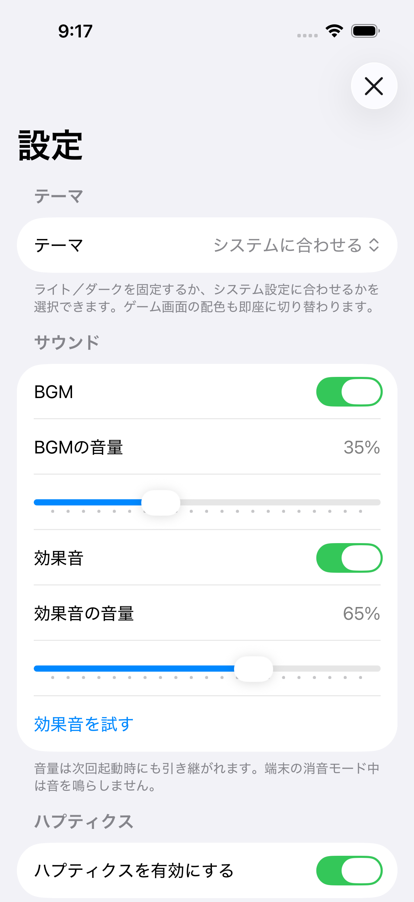
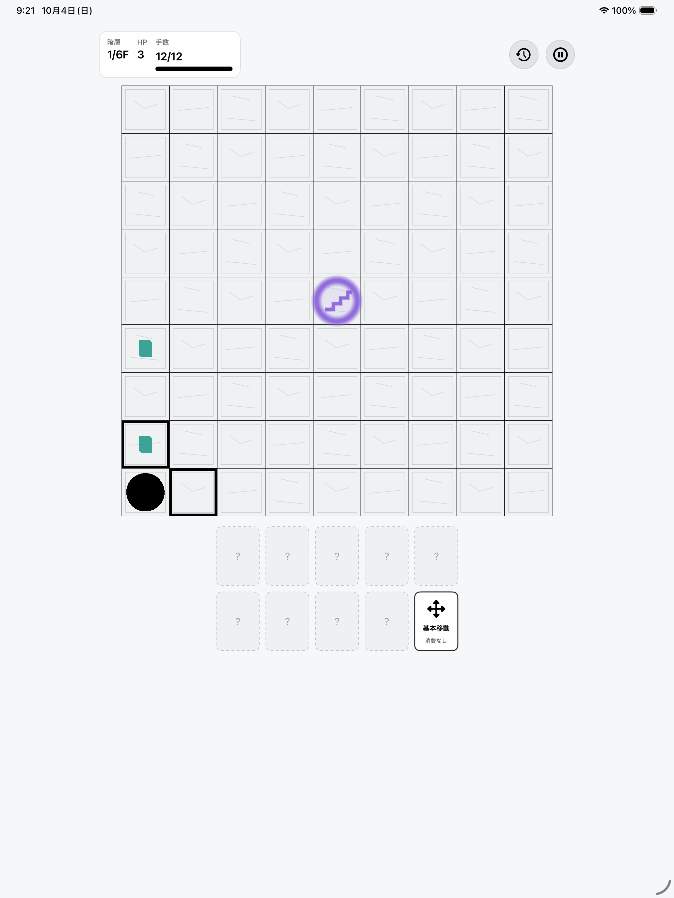

# MonoKnight 音源付き提出準備版

確認日: 2026年10月4日

## 現在の状態

作者のBGM/SE作成アプリを使って音源を生成し、MonoKnightへ組み込んだ。音量設定、停止・再開、プライバシー説明、提出用原稿と検証手順を追加した。コードとローカル検証は完了し、本番設定・配布署名・実機QAを待つ提出準備版である。ストア公開、アップロード、mainへのマージは行っていない。

## 完成した内容

- BGM4曲: タイトル、基礎塔、成長塔、試練塔。
- 効果音10点: 選択、行動確定、拾得、ダメージ、回復、フロアクリア、敗北、登頂、警告、遺物取得。
- BGM/効果音の個別オン・オフと音量保存。初期音量は35%/65%。
- 消音モード、ポーズ、広告、アプリの非アクティブ状態、通話などの割り込みに対応。複数の停止理由が重なっても、途中で勝手に再開しない。
- 広告側が音のカテゴリを変更した場合の復元と、ヘッドホン抜去後の明示操作による再開。
- 初回同意画面と設定から開くプライバシー説明、アプリ本体のPrivacyInfo.xcprivacy。
- ストア説明文、TestFlightの確認事項、公開用プライバシーポリシー原稿、本番値の未確定を検出する確認スクリプト。

ゲーム本体のルールは変更していない。旧モードの自動再抽選、旧Game Center送信、旧表示文言などを前提にしていたテストを現行の塔仕様へ更新した。

## 検証結果

| 確認 | 結果 |
| --- | --- |
| ゲーム/共通パッケージ | 476件合格 |
| 音源・ゲーム表示・ポーズ・広告/同意の関連アプリテスト | 174件合格（XCTest 166件、Swift Testing 8件） |
| iPhone 16 / iOS 26.5 | 音設定、保存、塔開始、ポーズ/再開、プライバシー説明のUIテスト2件合格 |
| iPad Pro 13インチ / iOS 26.5 | 同じUIテスト2件合格、縦画面の表示を目視確認 |
| 音源の静的検証 | 14点のSHA-256、44.1kHz/16bit/モノラル、無音端点、クリッピングなしを確認 |
| アプリ内リソース | 音源、アプリ本体とGoogle SDKのプライバシーマニフェスト、ATT説明、SKAdNetwork設定を確認 |
| Release Archive | iPhoneOS用の署名なしArchive作成成功。同梱音源と設定の静的検証も合格。配布署名・実機へのインストール・アップロードは未確認 |
| 公開条件の厳格チェック | 未完了。本番広告ユニットと公開連絡先/URLが未確定のため、意図どおり不合格になる |

Xcode 26.5、Google Mobile Ads SDK 12.14.0、Google UMP 3.1.0で確認した。既存シミュレーター保存先の権限問題を回避するため、既存設定を変更せず専用の保存先を利用した。シミュレーターUIテストの広告・購入サービスはモックを使う。本番広告の表示、Appleの購入処理、着信・消音などの実機動作を検証済みとは扱わない。

## 音源の出典

生成に使った作者アプリ:

- `Kurohyou3/bgm_creater`: `84b9438fb84aab72923913c78a443cdf6a208432`
- `Kurohyou3/game_se_creater`: `4ec0624ce320d94ddf2724f151aa656b700b2244`

外部楽曲・サンプル・MIDIは利用していない。生成条件、seed、編集可能な音符情報とWAVの記録は [`audio/manifest.json`](audio/manifest.json) と `audio/*.song.json` に保存した。元の非公開アプリのソースは公開リポジトリにコピーしていない。

## 公開直前に必要な作業

1. サポート用メール、公開サポートページ、プライバシーポリシーのURLを確定する。公開原稿では運営者名と施行日も確定する。
2. 本番のインタースティシャル広告ユニットIDを設定する。リワード広告は現行設定では未設定・無効のため、利用する場合は本番IDを追加して確認する。
3. Apple Developerチーム `5TAKV37ZM4`、Bundle ID `com.kokisato.MonoKnightApp` の配布署名、プロビジョニング、App Store Connect登録を確認する。バージョンは1.0、ビルドは1。再アップロード時はビルド番号を増やす。
4. 実機iPhone/iPadとTestFlightで通しプレイ、着信、消音、ヘッドホン/Bluetooth、広告、同意、`remove_ads_mk` の購入・復元を確認する。
5. ストアのプライバシー申告はGoogle SDKの収集も含めて回答する。年齢区分、販売条件、配信地域、価格、輸出に関する回答、提出用サイズのスクリーンショットを確定する。
6. `check-release-assets.py --strict` と署名済みArchiveの確認を通してから、提出・公開を判断する。

本番情報を作者から受け取るまで、IDや窓口を推測して入力しない。原稿、詳しい確認手順と設定場所は [`store-submission-draft.md`](store-submission-draft.md)、[`testflight-internal-distribution.md`](testflight-internal-distribution.md)、[`release-checklist.md`](release-checklist.md) を参照する。
